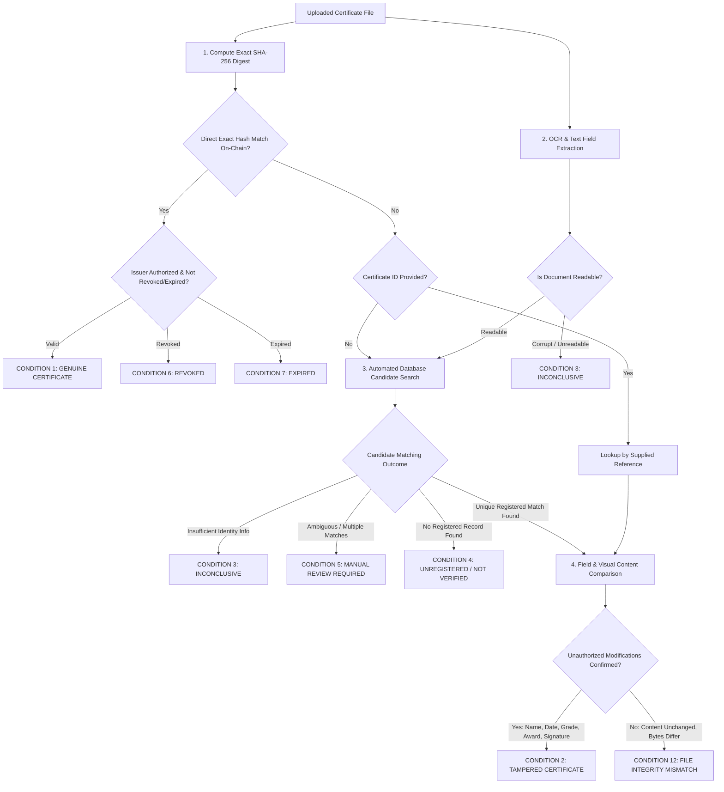

# AuthenTra

**AI-Assisted Digital Certificate Authenticity Verification Using Blockchain**

AuthenTra is a secure certificate verification platform that combines authoritative cryptographic proof on an Ethereum-compatible blockchain with automated OCR candidate matching, canonical metadata commitments, visual tampering inspection, and advisory machine learning anomaly detection.

The system uses **React/Vite** on the frontend, **FastAPI** on the backend, a **Solidity** smart contract running on a local **Ganache** blockchain, and an advisory **Random Forest** classifier.

---

## Quick Start

On Windows, start the entire local stack with one command from the project root:

```powershell
.\Start-AuthenTra.ps1
```

This starts the local blockchain (port 8545) and FastAPI backend (port 8000), checks the advisory ML model, seeds sample demo certificates, builds the production frontend, and validates service readiness.

Once started, open **http://127.0.0.1:8000** in your browser.

### Demo Accounts

All demo accounts use password: `AuthenTra-demo-2026!`

| Portal | Role | Demo Email | Purpose & Permissions |
| --- | --- | --- | --- |
| **User Portal** | `USER` | `verifier@authentra.demo` | Upload & verify certificates (up to 5 per batch); Certificate ID is completely optional; view private personal verification history. Cannot register credentials. |
| **Institution Portal** | `INSTITUTION_ADMIN` | `issuer@authentra.demo` | Accredited institution workspace; bulk issue certificates (up to 100 files) with on-chain registration & metadata commitments; revoke credentials. |
| **Admin Portal** (`#admin`) | `SYSTEM_ADMIN` | `owner@authentra.demo` | Governance portal; approve, suspend, or revoke institutions on-chain (`setIssuer`); view platform audit logs. Strictly cannot upload or register certificates. |

---

## Core Verification Architecture & Working of the Program

AuthenTra uses a multi-stage verification pipeline where **cryptography and trusted records are authoritative**, and **OCR, visual analysis, and machine learning are evidence-gathering and advisory**.



### Detailed Pipeline Workflow

1. **Exact Cryptographic Hashing**:
   - The SHA-256 hash is computed directly from the uploaded file's raw bytes (`hashlib.sha256(data).hexdigest()`).
   - The system immediately queries the smart contract via `lookupByHash(bytes32)` to check for an exact byte-for-byte match with a registered original certificate.

2. **OCR & Text Extraction**:
   - Extracts readable certificate metadata using PyMuPDF direct text streaming or English Tesseract OCR.
   - Extracts structured key fields: Recipient Name, Issuing Institution, Certificate Title/Award, Course, Issue Date, Grade/Marks, and Venue.
   - Assesses extraction confidence and document readability.

3. **Optional Certificate ID & Automated Candidate Search (`backend/search.py`)**:
   - The Certificate ID field is **optional** for standard users. Leaving it empty **never** returns `Inconclusive`.
   - If no Certificate ID is provided and the file hash differs:
     - `has_usable_identity_info()` checks if sufficient identity fields exist to distinguish a certificate.
     - `search_matching_certificate()` evaluates all registered certificates in the database using normalized exact, token, and fuzzy sequence matching ($\ge 0.82$ threshold).
     - If a unique candidate is identified, verification proceeds seamlessly against that original certificate.
     - If multiple candidates match within the ambiguity margin, it routes to **Manual Review Required**.
     - If no registered candidate matches, it generates **Unregistered / Not Verified**.

4. **Cryptographic Metadata Commitments & Tampering Detection (`backend/fields.py`)**:
   - At issuance, accredited institutions commit canonical certificate metadata bound to the certificate reference and file hash (`metadata_commitment = sha256(canonical_json + ref + file_hash)`), optionally ECDSA-signed by the issuer's private key.
   - During verification, if the file hash differs from the registered original, `compare_fields()` compares observed values against the trusted registered metadata.
   - Discrepancies in critical fields (recipient name, issue date, qualification/award title, institution, marks/grades) or protected visual elements (signatures/seals) confirm unauthorized modifications.
   - Every confirmed modification is cataloged with the original registered value, uploaded value, hash comparison outcome, and reason.

5. **Visual Anomaly & Transformation Analysis (`backend/visual_tampering.py`, `backend/transformations.py`)**:
   - Analyzes visual document regions for pixel-level splices, signature modifications, or seal tampering when reference templates are available.
   - Assesses image quality, skew angles, and PDF compression/re-export artifacts to distinguish formatting/compression shifts from malicious alterations.

---

## Result Generation Conditions

AuthenTra generates strictly evidence-grounded outcomes according to seven formal verification conditions:

| Condition | Verification Status | Category | Explanation |
| :--- | :--- | :--- | :--- |
| **1. Genuine Certificate** | `VERIFIED` | `VERIFIED` | The document is readable, the certificate is identified (with or without Certificate ID), uploaded SHA-256 matches the registered on-chain hash, issuer is authorized, and the credential is active. |
| **2. Tampered Certificate** | `TAMPERING_DETECTED` | `TAMPERING_DETECTED` | The certificate is identified, the file hash differs from the registered original, and content comparison confirms unauthorized modifications in recipient name, date, award/course, marks, or signature/seal. All modified fields are displayed in the discrepancy table. |
| **3. Inconclusive** | `INCONCLUSIVE` | `INCONCLUSIVE` | Document is unreadable, corrupted, OCR yields no usable identity fields, or verification evidence is contradictory. Never triggered simply because the Certificate ID was omitted or the hash differed. |
| **4. Unregistered / Not Verified** | `NOT_REGISTERED` | `NOT_REGISTERED_OR_INCONCLUSIVE` | The certificate is readable and identity fields were extracted, but no matching registered record exists in the AuthenTra database. Authenticity cannot be established (not labeled as tampered). |
| **5. Manual Review Required** | `MANUAL_REVIEW_REQUIRED` | `MANUAL_REVIEW_REQUIRED` | Multiple registered certificates match extracted details ambiguously, or evidence conflicts, requiring human reviewer intervention. |
| **6. Revoked Certificate** | `REVOKED` | `REVOKED` | The registered certificate is identified, but a trusted issuer or on-chain record confirms it has been revoked. Displays revocation status and reason. |
| **7. Expired Certificate** | `EXPIRED` | `EXPIRED` | The registered certificate is identified and authentic, but its validity end date has passed. Authenticity and validity are maintained as distinct attributes. |
| **Integrity Mismatch** | `POSSIBLE_TAMPERING_OR_FILE_MISMATCH` | `POSSIBLE_TAMPERING_OR_FILE_MISMATCH` | The file hash differs from the original registered hash, but certificate content is confirmed unchanged (e.g. PDF re-saved, re-exported, compressed, or metadata-altered). |

---

## Frontend Dashboard Features

The AuthenTra dashboard preserves its clean, responsive aesthetics while delivering transparent verification evidence:

- **Result Banner & Badges**: Distinct visual styling for Genuine (`VERIFIED`), Tampered (`TAMPERING_DETECTED`), Manual Review (`MANUAL_REVIEW_REQUIRED`), Unregistered (`NOT_REGISTERED`), Revoked (`REVOKED`), and Expired (`EXPIRED`).
- **Certificate Identification Card**: Displays the automatic matching status (e.g. *"Automatically Matched by Certificate Information"* or *"Matched by Exact File Hash"*) and the original registered certificate reference.
- **Detected Discrepancies & Modified Fields Table**: For tampered certificates, clearly presents:
  - **Modified Field** (e.g. Recipient Name, Issue Date, Award / Course Title, Marks / Grade, Visual Signature / Seal)
  - **Original Registered Value**
  - **Uploaded Certificate Value**
  - **Hash Comparison Result** (`MISMATCH`)
  - **Reason for Detecting Tampering**
- **Authoritative Hash & Blockchain Evidence**: Displays uploaded SHA-256, registered on-chain SHA-256, transaction hash, smart contract address, network ID, and issuer authorization state.
- **OCR & Advisory Analysis**: Shows OCR extraction confidence and advisory anomaly indicators without overriding authoritative blockchain checks.
- **Robust Timestamp Rendering**: Safe ISO timestamp parsing preventing `Invalid Date` across international timezones.

---

## Three-Role Architecture & Separation of Duties

AuthenTra enforces strict role separation across both the UI and backend APIs:

- **USER (Verifier)**
  - Access to verification dashboard and personal history.
  - Capped at 5 files per verification batch.
  - Certificate ID input is optional.
  - Blocked with HTTP 403 from registration endpoints.
- **INSTITUTION_ADMIN (Issuer)**
  - Restricted to accredited educational domains (`.edu`, `.ac.in`, `.edu.in`, `.res.in`, etc.) or vetted allowlists.
  - Requires email verification and system admin approval (`APPROVED` status) before issuing certificates.
  - Can bulk upload up to 100 certificates with OCR extraction and commit them to the blockchain.
  - Generates cryptographic metadata commitments.
  - Can revoke certificates issued by their own institution wallet.
- **SYSTEM_ADMIN (Governance)**
  - Dedicated admin portal (`#admin`).
  - Governs institutional access with on-chain synchronization via `setIssuer(wallet, approved)`.
  - Zero certificate upload or issuance capability (calls to `/api/verify` or `/api/certificates` return HTTP 403).

---

## Manual Terminal Setup

If you prefer running services manually across separate terminal windows:

```powershell
# 1. Start the local blockchain
node scripts/chain.mjs

# 2. In a second terminal: Train model, seed samples, build frontend, start server
.venv\Scripts\python.exe scripts/train_model.py
.venv\Scripts\python.exe scripts/seed_demo.py
node node_modules/vite/bin/vite.js build
.venv\Scripts\python.exe scripts/server.py
```

For frontend development with live hot-reloading:
```powershell
pnpm dev
```
Vite runs at `http://127.0.0.1:5173` and proxies API requests to `http://127.0.0.1:8000`.

---

## Running Tests

All test suites can be executed locally across all layers:

```powershell
# 1. Verification workflow & 14 required scenario tests (31 tests)
.venv\Scripts\python.exe -m pytest tests/test_verification_workflow.py -v

# 2. Complete backend test suite (248+ tests)
.venv\Scripts\python.exe -m pytest tests/test_api.py tests/test_core.py tests/test_report.py tests/test_e2e_security_review.py tests/test_end_to_end_registration_and_verification.py -v

# 3. Smart contract EVM checks (14 tests)
node tests/contract.mjs

# 4. Frontend validation checks (4 tests)
node --test tests/uploads.test.mjs

# 5. Production frontend build
node node_modules/vite/bin/vite.js build
```

---

## Project Structure

| Directory / File | Description |
| --- | --- |
| `src/App.jsx` | Main dashboard, authentication flow, result presentation, and discrepancy tables |
| `src/CertificateUpload.jsx` | Drag-and-drop certificate upload component with optional Certificate ID |
| `src/styles.css` | Accessible UI styling and status badge definitions |
| `backend/main.py` | FastAPI application endpoints, verification orchestration, and authentication |
| `backend/search.py` | Automated certificate database search, usable identity scoring, and fuzzy candidate matching |
| `backend/fields.py` | Canonical metadata commitments, field normalizers, and field-by-field diffing |
| `backend/visual_tampering.py` | Pixel-level visual tampering, seal anomaly, and signature inspection |
| `backend/transformations.py` | Rescan, compression, and format transformation advisory detection |
| `backend/report.py` | Cryptographic PDF verification report generator |
| `backend/upload_transport.py` | Bounded streaming upload transport preventing memory exhaustion |
| `backend/core.py` | Decision precedence, reference normalization, and hashing helpers |
| `backend/documents.py` | File validation, OCR text extraction, and model loading (`model_ready`) |
| `backend/registry.py` | Web3 contract integration and transaction signing |
| `backend/storage.py` | SQLite database schema, user accounts, and audit logs |
| `contracts/AuthenTraRegistry.sol` | Solidity smart contract for issuer authorization, registrations, and revocations |
| `scripts/chain.mjs` | Local Ganache blockchain runner, contract deployer, and `--check` validator |
| `scripts/seed_demo.py` | Generates sample demo certificates (`original.pdf`, `modified.pdf`, etc.) |
| `tests/test_verification_workflow.py`| Focused test suite for all 14 required certificate verification scenarios |
| `tests/conftest.py` | Disposable chain fixture for isolated integration testing |
| `.local/` | Ignored local runtime files (chain database, model artifact, and logs) |
