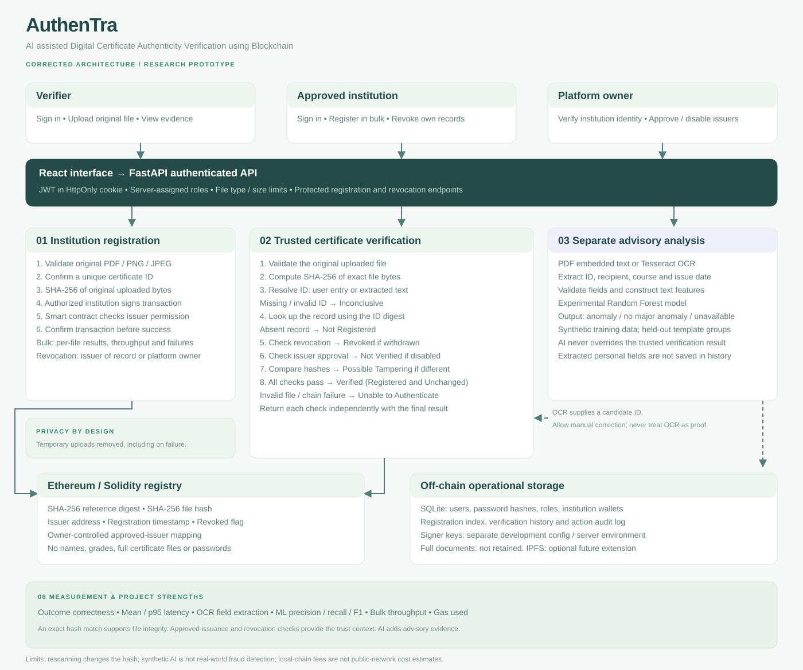

# AuthenTra

**AI assisted Digital Certificate Authenticity Verification using Blockchain**

This corrected architecture implements the six gaps described in the supplied research-gap document. Its contribution is a testable integration of issuer governance, exact-file integrity, separate AI advice, privacy controls and measurable verification outcomes. It is not a claim that these individual techniques are new or absent from all published systems.

## Changes to the original architecture

1. **Authenticate before upload access.** Account roles come from server records. Selecting an institution role does not authorize issuance.
2. **Introduce platform-owner governance.** An administrative account approves institution wallets after an external identity check. The contract enforces that approval, independently of the user interface.
3. **Look up the certificate ID first.** The reference is normalized and its SHA-256 digest identifies the record. The uploaded file's hash is compared only after retrieving that record. A modified registered file no longer disappears into a hash-only search.
4. **Check status and authority explicitly.** Revocation and issuer authorization are separate checks and outcomes. Their precedence is documented below.
5. **Hash the untouched file bytes.** OCR, conversion, rendering and AI never change the file used for the integrity comparison.
6. **Keep AI findings separate.** The model can raise a warning for a cryptographically verified file, or miss an alteration. Neither result overrides the trusted checks.
7. **Use accurate result wording.** Verified means “Registered and Unchanged,” with an approved issuer and active record. A mismatch means “Possible Tampering,” with an explanation that re-saving or scanning also changes the hash.
8. **Handle uncertainty explicitly.** Missing or invalid IDs produce Inconclusive. Invalid documents or blockchain failure produce Unable to Authenticate. An OCR failure can be recovered by supplying the ID manually; the trusted checks must still pass.
9. **Retain minimal data.** Queued certificate bytes are staged privately in SQLite and cleared after processing. Private batch reports retain outcomes and extracted fields; verification history records an ID, hash, result, elapsed processing time and advisory status. See UPLOADS.md for retention and worker behavior.
10. **Measure actual behavior.** The application reports processing times, batch results and gas. A separate script measures HTTP verification latency and controlled outcome correctness.

## Research gaps translated into project strengths

| Gap from the supplied document | Implemented strength | Evidence / demonstration |
| --- | --- | --- |
| Manual verification | One upload triggers file validation, extraction, trusted checks and an explainable result | React verification workspace and protected FastAPI endpoint |
| Altered versus unregistered documents | ID-based record lookup followed by exact SHA-256 comparison | Modified known-ID document → Possible Tampering; unknown ID → Not Registered |
| No combined AI and cryptographic analysis | Separate OCR/Random Forest advisory panel alongside authoritative checks | An AI warning cannot change Verified into a rejection; AI cannot promote an unregistered file to Verified |
| Issuer trust and revocation | Platform-owner approval, institution-bound signing, backend checks and Solidity permissions | Contract tests cover unauthorized registration, cross-issuer revocation, disabled issuers and permanent revocation |
| Privacy and blockchain cost | Digests and lifecycle metadata on-chain; operational records off-chain; temporary-file cleanup | No certificate file, recipient name or grade stored on-chain; queued bytes cleared after processing |
| Missing performance evidence | Measured correctness, extraction, latency, bulk throughput, gas and model evaluation | Evaluation page, machine-readable metrics, backend tests and contract tests |

These are advantages over the specific manual or hash-only baselines discussed in the supplied material. To claim novelty relative to existing research, add a cited paper-by-paper comparison. The current implementation does not establish that no existing system provides similar capabilities.

## Components and responsibilities

| Component | Implementation | Responsibility |
| --- | --- | --- |
| Web interface | React, Vite, responsive CSS | Sign-in, verification, evidence, history, institution tools and administration |
| Application service | Python FastAPI | Authentication, authorization, file validation, hashes, trusted decision order and operational records |
| Authentication | Scrypt password hashing; signed JWT in HttpOnly, SameSite=Strict cookie | Server-assigned verifier, institution and platform-owner roles |
| Text extraction | pypdf embedded text; Tesseract engine through a local Node worker | Recover certificate fields; no cloud OCR or certificate transmission |
| PDF rendering | pypdfium2 | Render first page of scanned PDFs for OCR; SHA-256 still covers the entire uploaded file |
| Advisory model | scikit-learn Random Forest | Flag experimental text anomalies; report limitations and synthetic evaluation |
| Integrity | SHA-256 | Hash exact original bytes and compare against the stored digest |
| Blockchain | Solidity contract on persistent local Ganache chain, chain ID 1337 | Approved-issuer mapping, immutable registration and revocation |
| Operational database | SQLite | Accounts, institution wallets, registration index, private history and audit events |
| Signing | Server-side development configuration; environment-based configuration outside demo mode | Never expose signing keys to the browser or store them in ordinary database rows |

Tesseract is the OCR engine in this implementation. A local JavaScript worker runs it with packaged English language data; it does not require a separately installed Tesseract executable. This replaces the Python wrapper shown in the initial plan while preserving the intended OCR technology.

## Authoritative decision order and result categories

The backend evaluates certificate verification in strict order. The first applicable rule determines the primary category:

| Order | Condition | Required Result Category | UI Label & Explanation |
| --- | --- | --- | --- |
| 1 | File is corrupt, unsupported, empty, or fails required validation | `INVALID_FILE` | **Invalid File** — File validation failed before processing. |
| 2 | Blockchain or trusted RPC node cannot be reached | `VERIFICATION_UNAVAILABLE` | **Verification Unavailable** — Honest failure reporting; never guessing or simulating. |
| 3 | No readable certificate reference detected or provided | `NOT_REGISTERED_OR_INCONCLUSIVE` | **Not Registered or Inconclusive** — Reference required for lookup. |
| 4 | Supplied reference has no registration on the blockchain | `NOT_REGISTERED_OR_INCONCLUSIVE` | **Not Registered or Inconclusive** — No record found; does not prove tampering. |
| 5 | Registered on-chain record is marked revoked | `REVOKED` | **Revoked** — Permanently revoked by issuer or administrator. |
| 6 | Issuing institution wallet is not currently authorized | `ISSUER_NOT_AUTHORIZED` | **Issuer Not Authorized** — Issuer approval revoked or suspended. |
| 7 | Uploaded original file SHA-256 differs from registered hash | `POSSIBLE_TAMPERING_OR_FILE_MISMATCH` | **Possible Tampering or File Mismatch** — Hash mismatch against trusted record; note that re-exporting or rescanning also alters binary bytes. |
| 8 | Record exists, is active, issuer approved, and original hash matches | `VERIFIED` | **Verified** — Registered and unchanged; confirmed active on-chain. |

An incorrect or altered ID produces `NOT_REGISTERED_OR_INCONCLUSIVE`. The system never performs an arbitrary blind hash search across all records to conclude tampering. A hash mismatch against an identified trusted record produces `POSSIBLE_TAMPERING_OR_FILE_MISMATCH` without claiming proven deliberate fraud, since re-saving or rescanning alters file bytes. An exact hash match is never accepted if the issuer is unauthorized or the certificate has been revoked.

## Institution lifecycle

1. The owner checks an institution's identity outside the prototype and creates its account with a dedicated wallet.
2. The owner approves that wallet through a contract transaction. Account creation alone grants no issuance rights.
3. The institution uploads original files with unique certificate IDs. The prototype supports multiple PDF/PNG/JPEG files; ZIP archives and CSV manifests are not implemented.
4. The backend validates file contents, computes canonical SHA-256 digests from original unmodified bytes, and analyzes fields with PDF text extraction and local Tesseract OCR.
5. If OCR confidence is low (<50%) or critical fields are ambiguous/missing, the item enters `AWAITING_REVIEW`, prompting the institution administrator to verify or correct fields before on-chain registration.
6. The backend signs through the institution's verified server-side signer, broadcasts the transaction to the EVM node, and enters `PENDING_BLOCKCHAIN`.
7. Once the transaction receipt is confirmed, the backend performs an **independent on-chain read-back** (`lookup(reference)`), verifying that the recorded file hash matches the uploaded file hash and the issuer matches the authorized wallet. Only upon read-back verification does the status transition to `REGISTERED_ON_BLOCKCHAIN`. Mock hashes and simulated registrations are strictly forbidden.
8. Each batch row receives a separate success/failure result. Partial success is explicit, not rolled back or described as a complete success.
9. An approved institution can revoke its own records. The owner can revoke any record, including one from a disabled issuer. A different institution cannot revoke it.
10. Revocation is permanent. A corrected certificate requires a new ID. A previously used ID cannot be overwritten or reused.

## Storage and privacy

**On-chain:** Keccak-256 of normalized reference, SHA-256 of original file bytes, issuer wallet, registration timestamp, revoked flag, approved-issuer mapping and contract events. Sensitive recipient names, certificate files, and course information are never put on-chain.

**Off-chain:** Password hashes, user identities, roles, institution wallets, registration transaction receipts, block numbers, network identifiers, extracted metadata (recipient, course, issue date, OCR confidence), verification history, and non-sensitive audit records (which omit student names and document text). Full certificate files are never stored in the database.

**Upload staging:** A bounded receiver spools request bodies to temporary files before multipart parsing. Valid files are staged in SQLite for the serial background worker. Staged bytes are cleared after each outcome; OCR image files and request spool files are closed on completion or failure. Private job reports retain extracted personal fields. Legacy single-file verification returns these fields directly without persisting them. See [UPLOADS.md](UPLOADS.md).

**Rescanning and Hashing:** SHA-256 is computed strictly over raw binary file bytes. Rescanning or re-exporting a certificate creates different byte sequences (compression, metadata, raster differences), altering the file hash even if the visible text appears identical.

**Not anonymous:** hashes and reference digests are pseudonymous, not a guarantee of anonymity. Predictable IDs can be guessed, and wallet/timing information can be correlated. Public-chain deployment needs a specific privacy review and an ID policy with sufficient entropy.

IPFS is omitted because permanent document storage is unnecessary for this prototype. Adding public IPFS without encryption and consent would conflict with the privacy objective.

## What the AI experiment actually does

The Random Forest uses ten text features: length, line count, digit fraction, uppercase fraction, mean word length, presence of ID/name/course, date validity and selected suspicious terms. It does not inspect seals, signatures, typography, image regions or document provenance.

The experiment creates 480 synthetic text examples across 20 template groups. Training uses 360 examples; 120 examples from five held-out groups form the test set. The generated anomalies are simple missing fields, invalid dates or suspicious words. There is shared vocabulary across groups. Perfect performance on this generated task is possible and does **not** establish real-world fraud accuracy.

The generated legitimate demonstration PDF can receive an AI anomaly warning even while all trusted checks pass. This observed false positive is an important limitation. A convincingly edited name can also evade the model. The UI labels its score as a model anomaly score, not a probability that a certificate is forged.

## Evaluation and remaining scope

Run the provided tests and evaluation scripts; machine-specific measurements are saved under `.local/` and displayed in the application. The initial controlled evaluation checks original, modified, unknown-ID, revoked, revoked-plus-modified, disabled-issuer, scanned and invalid-file cases. Four fields are measured on one generated scan. This is a smoke evaluation, not evidence of general OCR accuracy or large-scale throughput.

Local development gas is measured, but local gas prices are artificial. No claim about real public-chain fees or 3,000-record scalability is made. Those require a defined workload and target network.

Before production: replace demonstration accounts and deterministic keys; provision a separate protected signing service; enforce HTTPS, deployment-wide rate and upload limits; isolate untrusted document parsing; add account recovery and token invalidation; implement reliable transaction/index reconciliation; run security review; obtain a representative consented dataset; and evaluate realistic loads. Current transaction submission waits for a receipt; a network timeout can require manual chain inspection before retrying. Verification treats the chain as authoritative even if the operational index is incomplete.

Future work: signed structured credentials with portable proof verification, QR-based ID resolution, real visual tamper analysis, encrypted optional storage, institution identity-verification workflows and public-network experiments.
